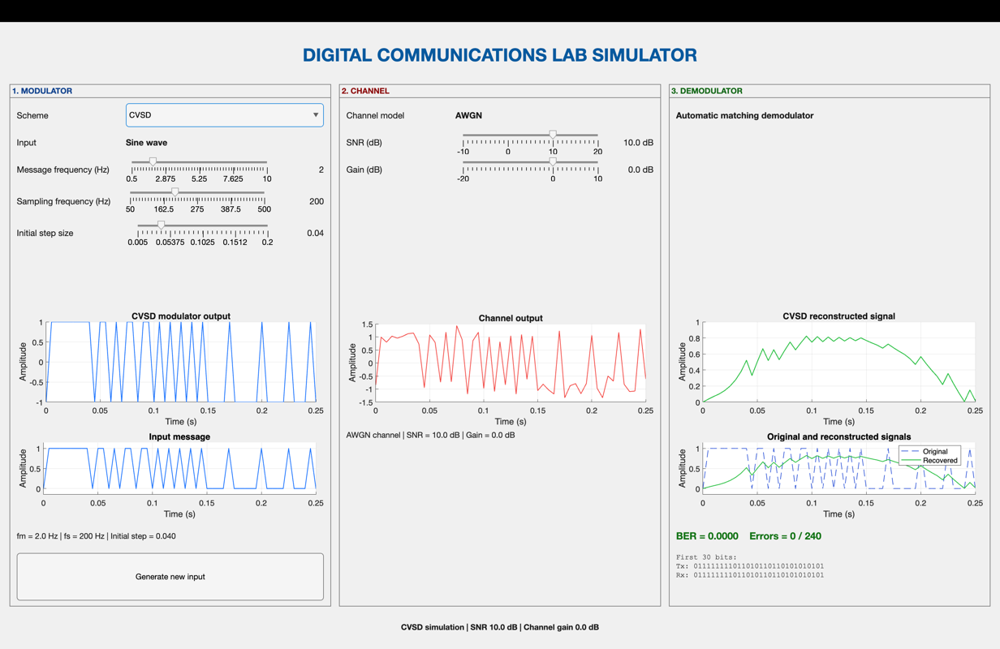

# Interactive Digital Communications Laboratory Simulator — MATLAB

**Digital Communications Lab · MATLAB / App Designer-style programmatic UI**

A graphical teaching tool that lets users experiment with the full **modulator → noisy channel → demodulator** chain. It supports **ASK, FSK, PWM, Delta Modulation (DM), and Continuously Variable Slope Delta modulation (CVSD)**, with interactive parameter controls and plots of input, transmitted, received, and recovered signals.



## Features

- Five selectable modulation techniques: `ASK`, `FSK`, `PWM`, `DM`, `CVSD`.
- Context-sensitive controls for the active modulation scheme (e.g. carrier frequency, bit rate, sampling rate, step size).
- Adjustable **SNR** and channel gain.
- Visual comparison of modulated, noisy, and demodulated waveforms.
- Recovered-bit and performance/error displays where applicable.
- **Generate new input** button for repeating experiments with a new input sequence.

## Files

| File | Purpose |
| --- | --- |
| `Codes/CommLabAppV6_1.m` | MATLAB app class; UI and simulation logic |
| `Codes/runCommLabV6_1.m` | Launcher script |
| `assets/matlab-app.png` | Screenshot extracted from the submitted project report |
| `docs/report-redacted.pdf` | Original Persian-language technical report |

## Getting started

1. Install **MATLAB** with support for `uifigure`/`uigridlayout` App Designer components. The original MATLAB release was not recorded.
2. Open MATLAB and make `Codes/` your current folder, or add it to your MATLAB path.
3. Launch the application:

   ```matlab
   runCommLabV6_1
   ```

   Alternatively:

   ```matlab
   app = CommLabAppV6_1;
   ```

4. Choose a modulation scheme, adjust its parameters and the channel settings, and compare the plotted signals and metrics.

## Limitations

This is an **educational baseband/signal simulation**, not a measured hardware communication link or a standards-compliant transceiver. The supplied archive did not specify an exact MATLAB release, and the code has not been executed in MATLAB during this GitHub packaging pass.

**Author:** Sina Hemmati · B.Sc. Electrical Engineering (Telecommunications), K. N. Toosi University of Technology.
